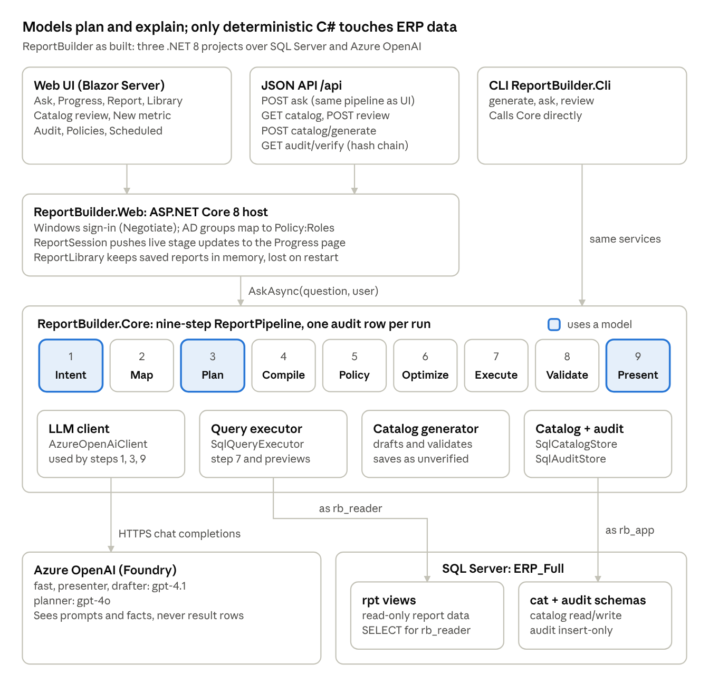
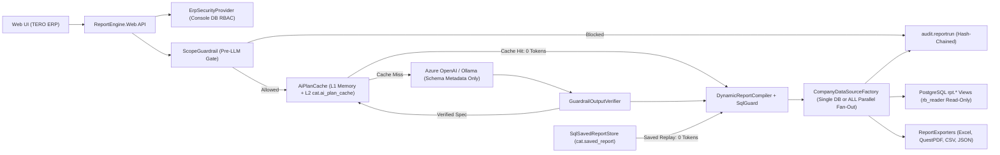
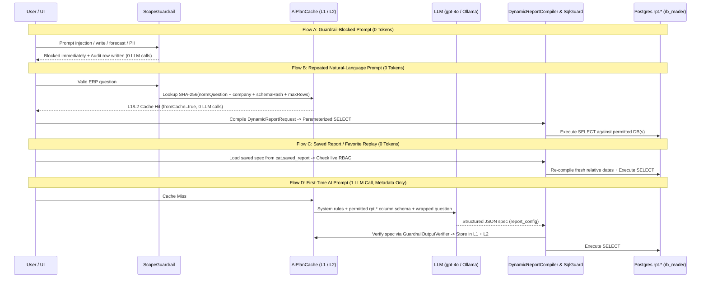

# TERO ERP AI Report Engine — Architecture

This document describes the architecture of `ReportEngine.Web` and `ReportBuilder.Core`, including the **Zero-DB-Access AI** design, **Multi-Layered Guardrails**, **Two-Tier RBAC-Safe AI Plan Cache**, and **Saved Reports (0-Token Replay)**.

---

## 1. End-to-End System Topology

---

## 2. Request Lifecycle & Token Optimization Flows

---

## 3. Core Subsystems

### A. Zero-DB-Access AI (`AiReportAssistant`)
- Implemented in [AiReportAssistant.cs](src/ReportBuilder.Core/Pipeline/AiReportAssistant.cs).
- Models receive **only** permitted `rpt.*` view descriptions and column metadata (`ErpAreaViewMeta`) — they never hold PostgreSQL credentials, never issue SQL against the database, and never see query result rows.
- Uses strict structured JSON outputs (`additionalProperties: false`, all fields in `required`, `Temperature: 0`) via [AzureOpenAiClient.cs](src/ReportBuilder.Core/Llm/AzureOpenAiClient.cs) (supporting `AzureOpenAI` and local `Ollama`).

### B. Multi-Layered Anti-Hallucination Guardrails (`ModelGuardrails.cs`, `SqlGuard.cs`)
- **Layer 1 — Pre-LLM `ScopeGuardrail.InspectInput`**: Deterministically rejects empty/oversized inputs, prompt injections, DDL/DML writes, forecasts/predictions, general-knowledge trivia/coding prompts, PII/secrets, and RBAC-blocked column references before calling the model (0 tokens). Untrusted user text is isolated inside `<user_question>...</user_question>` tags.
- **Layer 2 — Strict Output Schema & Closed-World Verification (`GuardrailOutputVerifier`)**:
  - Hard-rejects hallucinated views, unknown or blocked columns, `SUM`/`AVG` on non-numeric types, unrecognized `HAVING` aliases, invalid `RelativePeriod` tokens, and unknown reconciliation areas.
  - Strips redundant `company_code` filters and ungrounded filter values not present in the user's question (returning transparent warnings), clamps `Limit`, and replaces ungrounded explanations with deterministic factual summaries.
- **Layer 3 — Presenter Summary Verification**: [Presenter.cs](src/ReportBuilder.Core/Pipeline/Presenter.cs) verifies that every numeric value, percentage, and `Certified`/`Unverified` label in LLM summaries matches the deterministic `Facts` payload; any violation falls back cleanly to fixed templates.
- **Layer 4 — SQL Safety Gate (`SqlGuard`)**: Enforces a single read-only `SELECT` exclusively over permitted `rpt.*` views, blocking base schemas (`common`, `finance`, `sales`, `trading`, `hrms`, `cat`, `audit`, `pg_catalog`, `information_schema`), `UNION`/`INTERSECT`/`EXCEPT`, subqueries in `FROM`/`JOIN`, comments, and disallowed parameters.

### C. Two-Tier RBAC-Safe AI Plan Cache (`AiPlanCache`)
- Implemented in [AiPlanCache.cs](src/ReportBuilder.Core/Pipeline/AiPlanCache.cs).
- **L1 Tier**: Process-local `ConcurrentDictionary` with a **24-hour TTL** and **1,000-entry** capacity limit (oldest 10% evicted on overflow).
- **L2 Tier**: PostgreSQL table `cat.ai_plan_cache` (created via [60_cache_and_saved_reports.pg.sql](sql/60_cache_and_saved_reports.pg.sql)), persisting cached plans across app restarts and tracking `hit_count` and `last_hit_at_utc`. Fails gracefully to L1-only if L2 is unavailable or not yet migrated.
- **RBAC Isolation & Auto-Invalidation Key**:
  $$\text{cache\_key} = \text{SHA-256}\bigl(\text{normalize}(q) \mid \text{company} \mid \text{SHA-256}(\text{permittedViews} \setminus \text{blockedColumns}) \mid \text{maxRows}\bigr)$$
  Two users with different permitted views or blocked columns compute distinct cache keys; adding, removing, or modifying a column/view in `rpt.*` changes `schema_hash` and invalidates old entries automatically.
- Only verified, non-blocked results are cached. Returned specs are defensively cloned and marked with `fromCache = true` and `cacheSource = "Memory" | "Database"`. Admins can inspect metrics via `GET /api/admin/ai-cache/stats` and purge via `DELETE /api/admin/ai-cache`.

### D. Saved Reports / Favorites (`SqlSavedReportStore`)
- Implemented in [SavedReportStore.cs](src/ReportBuilder.Core/Data/SavedReportStore.cs).
- Stores validated `DynamicReportRequest` JSON specs in PostgreSQL `cat.saved_report` (falling back seamlessly to thread-safe JSON storage at `.local/saved_reports.json` if table `60` is not yet deployed).
- Supports personal (`is_shared = false`) and team-shared (`is_shared = true`) favorites filtered by live user RBAC (`AllowsView` + `AllowsCompany`).
- Replaying a saved report (`POST /api/reports/saved/{id}/run`) uses **0 LLM tokens**, re-evaluates permissions dynamically, resolves relative date periods (`last_3_quarters`, `ytd`, etc.) against current UTC time via `DynamicReportCompiler`, executes SQL over `rb_reader`, increments `run_count`, and logs an audit row.

### E. Security, Multi-Company Routing & Audit Trail
- **RBAC (`ErpSecurityProvider`)**: Resolves users, companies, roles, claims, and menu permissions directly from Console DB ASP.NET Identity + ERP tables mapped via `cat.module_view_map`.
- **Multi-Company Fan-Out (`CompanyDataSourceFactory`)**: Routes single-company queries to the tenant DB (`cat.company_database_map` / `tenants.json`) and executes `Company = ALL` queries in parallel across all unique permitted DBs, tagging each row with its source `company_code` and skipping DBs where a view is absent.
- **Least-Privilege PostgreSQL Roles**:
  - `rb_reader`: `SELECT` only on `rpt.*` views.
  - `rb_app`: Metadata management (`cat.*`) + append-only `audit.reportrun` (insert-only trigger blocks `UPDATE`/`DELETE`).
  - `rb_designer`: `CREATE/REPLACE VIEW` in `rpt` schema upon Admin approval.
- **Document & Pack Exports**: [ReportExporters.cs](src/ReportEngine.Web/Services/ReportExporters.cs) and [GroupReportPackService.cs](src/ReportEngine.Web/Services/GroupReportPackService.cs) render Excel (`.xlsx`), QuestPDF single/group packs, CSV, JSON, and zero-data query catalog PDFs.
